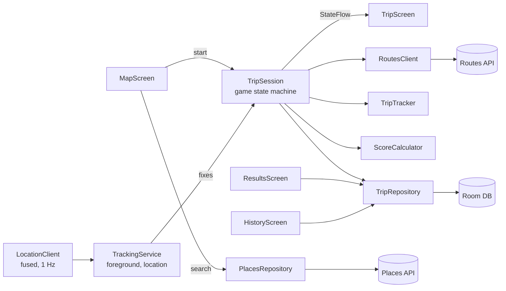

# BlindNav

An Android game that tests how well you remember a driving route.

Pick a destination and BlindNav shows Google's traffic-aware optimal route for 10, 30 or 60 seconds. Then the map
disappears. You drive there from memory while the app records your GPS track, and when you arrive you're scored
against the optimal route on time, distance and how closely you followed it.

Built with Kotlin, Jetpack Compose, Room and Google Maps Platform (Maps SDK, Routes API, Places API).

## How a round works

1. **Choose a destination.** Search with Places autocomplete, tap a point of interest, or long-press to drop a pin.
   It must be at least 300 m away. The card shows your best score there so far.
2. **Pick a memorize time.** 10 s (×1.5 points), 30 s (×1.2) or 60 s (×1.0).
3. **Memorize.** The app fetches the optimal driving route and shows it until the countdown ends, you tap
   *I'm ready*, or you start moving.
4. **Drive blind.** The screen shows only the destination name and a timer. The clock starts when you first move,
   not when the map hides. Tracking keeps running with the screen off.
5. **Arrive.** The trip ends automatically when you're within 75 m of the destination and have slowed down.
   Within 250 m you can also tap *Finish*. If you're lost, *Give up* discards the trip and opens Google Maps
   directions.
6. **Results.** A map overlays your track on the optimal route, with detours in red, alongside the score breakdown
   and how the trip compares with your previous best there and your average.

Set the trip up before you pull out and keep the phone in a mount: the drive screen needs no interaction until you
arrive.

## Scoring

| Component   | Weight | How it's measured                                                                                      |
|-------------|--------|--------------------------------------------------------------------------------------------------------|
| Time        | 35%    | Google's traffic-aware ETA ÷ your time, capped at 1 (beating the ETA earns nothing extra)              |
| Distance    | 35%    | Optimal route length ÷ your distance, capped at 1                                                      |
| Route match | 30%    | Share of the optimal route (sampled every 25 m, length-weighted) lying within 40 m of your track        |

The weighted sum × 1000 gives a base score and grade (S ≥ 950, A ≥ 880, B ≥ 780, C ≥ 650, D ≥ 500, else F).
Points are the base × the memorize-time multiplier.

**Detours** are stretches more than 50 m off the optimal route and at least 100 m long. Anything within 150 m of the
start or end is ignored so parking lots and road snapping don't count. Detours are drawn on the results map; they cost you through
route match and distance rather than as a separate penalty.

## GPS tracking

`TripTracker` is pure Kotlin with no Android dependencies, so it's fully unit-tested:

- Drops fixes worse than 25 m accuracy, and spikes that imply more than 70 m/s from the last good fix.
- Adds a track point only every 10 m, so jitter while stopped doesn't inflate distance.
- Starts the clock once two consecutive fixes are more than 25 m from the origin.
- Detects arrival within 75 m of the destination *or* the road-snapped route end (dropped pins often sit off-road),
  at under 8 m/s so driving past doesn't count. A manual finish cuts the track at your closest approach.
- Times everything on the monotonic `elapsedRealtime` clock, never wall time.

## Architecture



`TripSession` is an app-scoped state machine (`Idle → Preparing → Memorizing → Driving → Finishing → Finished`, or
`Failed`) exposed as a `StateFlow`. The foreground service holds no game logic; it only feeds location fixes in and
stops itself when the trip ends. Dependencies are wired by hand in `AppContainer`.

```
app/src/main/java/com/blindnav/
├── data/        Room entity, DAO, repository (history, bests, comparisons)
├── geo/         Haversine, local planar projection, polyline index and codec
├── location/    Fused location provider wrapper
├── places/      Places autocomplete and details
├── routes/      Routes API computeRoutes client
├── scoring/     Score, grade, route match, detours
├── trip/        TripSession, TripTracker, TrackingService, notifications
└── ui/          Compose screens and ViewModels: map, trip, results, history
```

## Setup

You need Android Studio (its bundled JDK 21 runs Gradle), an Android 8.0+ device or emulator, and a Google Cloud
project with billing enabled.

1. In Google Cloud, enable **Maps SDK for Android**, **Routes API** and **Places API (New)**, and create an API key.
2. Add the key to `local.properties` in the project root (gitignored):

   ```properties
   MAPS_API_KEY=your-key-here
   ```

3. Recommended: restrict the key to those three APIs and to Android apps with package `com.blindnav` and your
   signing certificate's SHA-1 (`./gradlew signingReport`). The app sends the package and certificate headers the
   Routes REST API needs for a restricted key.
4. Build and install:

   ```sh
   make build     # assemble the debug APK
   make install   # install on the running emulator or device
   ```

   Or open the project in Android Studio and run the `app` configuration. The Makefile points `JAVA_HOME` at
   Android Studio's JBR on Windows; elsewhere, run `make JAVA_HOME=/path/to/jdk21 build`.

The app asks for precise location (required for scoring) and, on Android 13+, notifications for the
tracking and arrival alerts.

## Testing

```sh
make test   # JVM unit tests: geometry, polyline codec, scoring, trip tracker, Routes JSON, formatting
make lint   # Android lint
```

### Driving on the emulator

`tools/replay_route.py` (Python 3, uses `adb`) fakes a drive so you can test end to end at a desk. Debug builds log
the fetched route to logcat, and the script replays it as one GPS fix per second.

```sh
make park START=37.7793,-122.4193    # put the emulator at the start point, then start a trip in the app
make replay                          # while the Memorize screen is up: drive the optimal route
make replay ARGS="--detour 120"      # shift the middle third 120 m sideways (expect a red detour)
make replay ARGS="--pass-by"         # overshoot the destination at speed, then come back slowly
make replay ARGS="--noise 5"         # add 5 m of Gaussian GPS noise
make replay ARGS="--speed 25"        # cruise at 25 m/s instead of the default 13.4
```

## Limitations and constraints

- Driving only.
- If Android kills the process mid-trip, the trip is lost: nothing is saved until it's scored.
- Each trip makes one traffic-aware Routes call, billed as Compute Routes Pro. Place details request only the
  Essentials-tier fields.
- Google Maps Platform terms allow caching route geometry for at most 30 days, so stored optimal routes are cleared
  after that. Scores and your own tracks are kept.
- The terms also rule out building turn-by-turn navigation on Routes data, so *Give up* hands off to the Google Maps
  app instead.
